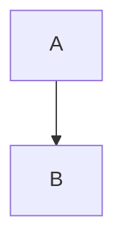
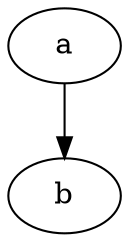
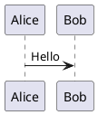

# Installed runtime

Inline $2x+1$ and $\ce{H2O}$.





```echarts
{"xAxis":{"data":["A","B"]},"yAxis":{},"series":[{"type":"bar","data":[1,2]}]}
```

```abc
X:1
T:Example
K:C
CDEF|
```

```flowchart
st=>start: Start
e=>end: End
st->e
```

```markmap
# Root
- Child
```

```mindmap
- Root
    - Child
```

```smiles
CCO
```

```math
x^2
```



```rust
fn main() { let answer = 42; }
```
