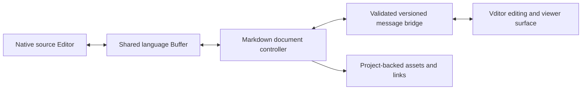

# Implementation plan: Markdown viewer and editor

Status: Phases 0 through 4 are complete under the revised scope: the reference baseline is frozen, automated CPU offscreen CEF viability is verified on Windows/X11/Wayland, and the shared-buffer Item provides confined, source-preserving Vditor 3.11.2 modes, viewer, project images, local renderers, themes, and CSS. Phase 4 merged in [PR 6](https://github.com/mina-account/lathe/pull/6) after independent review 13 reported clean. Phase 5 opening/settings/persistence/install/packaging is complete with actual installed Windows/X11/Wayland evidence. The user's Phase 6 full native/manual acceptance run remains pending.
Created: 2026-10-12.
Repository baseline: `b58ba5990a`, with existing local changes excluded from this plan.

## 1. Objective

Add a Markdown workspace item to Lathe with functional parity with [zaaack.markdown-editor on the VS Code Marketplace](https://marketplace.visualstudio.com/items?itemName=zaaack.markdown-editor). Users must be able to read rendered Markdown, edit through instant rendering, WYSIWYG, or split mode, and open the same document in Lathe's source editor without creating independent document copies.

The target is a complete editor, including formatting, image insertion, themes, custom CSS, extended Markdown syntax, and the reference extension's diagram support. A source editor with a read-only preview is an intermediate milestone, not completion of this plan.

Scope revision: supported delivery platforms are Windows and Linux (X11 and Wayland). macOS checks, accessibility checks, and visual pixel-readback acceptance are excluded from deliverables. Historical evidence remains recorded. The user will run the full native/manual UI acceptance suite and resolve UI bugs at the end of all implementation phases, in Phase 6. Native input, IME, selection, shortcuts, focus, overlays, DPI, and workspace/window interactions still require implementation; automated correctness checks continue during each phase. Packaging and installed-runtime acceptance belong to Phase 5. This revision does not reduce feature parity, document fidelity, shared history, bridge validation, or security requirements.

## 2. Reference baseline and scope

Research inspected the Marketplace description and the extension's source on 2026-10-12. Freeze parity against extension commit [`033c6242cf96615fd0c88bed73d5428b76e3a44b`](https://github.com/zaaack/vscode-markdown-editor/tree/033c6242cf96615fd0c88bed73d5428b76e3a44b). Its [manifest](https://github.com/zaaack/vscode-markdown-editor/blob/033c6242cf96615fd0c88bed73d5428b76e3a44b/package.json) declares version `0.1.21`; its [frontend lockfile](https://github.com/zaaack/vscode-markdown-editor/blob/033c6242cf96615fd0c88bed73d5428b76e3a44b/pnpm-lock.yaml) resolves Vditor `3.11.2`, despite the dependency range starting at `^3.8.4`.

Source HEAD is not proof that every feature is present in the published Marketplace package. Phase 0 must compare the installed package with this source baseline and record any differences. Treat additional source behavior as an explicitly tracked target, not an undocumented assumption about the release.

Reference sources:

- [Marketplace overview](https://marketplace.visualstudio.com/items?itemName=zaaack.markdown-editor): advertised editor modes, synchronization, image handling, themes, copying, renderers, and opening workflows.
- [Extension manifest](https://github.com/zaaack/vscode-markdown-editor/blob/033c6242cf96615fd0c88bed73d5428b76e3a44b/package.json): file associations, commands, keybindings, and five exposed settings.
- [Extension host](https://github.com/zaaack/vscode-markdown-editor/blob/033c6242cf96615fd0c88bed73d5428b76e3a44b/src/extension.ts) and [frontend initialization](https://github.com/zaaack/vscode-markdown-editor/blob/033c6242cf96615fd0c88bed73d5428b76e3a44b/media-src/src/main.ts): document integration, persistence, image requests, and Vditor configuration.
- [Toolbar](https://github.com/zaaack/vscode-markdown-editor/blob/033c6242cf96615fd0c88bed73d5428b76e3a44b/media-src/src/toolbar.ts) and [find implementation](https://github.com/zaaack/vscode-markdown-editor/blob/033c6242cf96615fd0c88bed73d5428b76e3a44b/media-src/src/search.ts): actual available editing controls and source-baseline additions.
- [Vditor documentation](https://github.com/Vanessa219/vditor/blob/4535ffb0c6b70809a0d5bcb477d9568e297ae83f/README_en_US.md): upstream syntax and rendering capabilities. Validate against bundled `3.11.2`; newer upstream documentation does not establish extension behavior.

Do not automatically include every optional Vditor capability. Microphone recording, speech synthesis, third-party publishing, server uploads, and PDF export are outside scope unless Phase 0 establishes that they are exposed by the reference extension. Preserve ordinary Markdown and HTML content that uses media without adding unrelated creation workflows.

## 3. Feature parity and acceptance matrix

Every row is required unless explicitly identified as a source-baseline addition. Maintain fixtures and automated correctness evidence during implementation; record full native/manual UI evidence in the user's final Phase 6 acceptance run. Earlier synthetic browser/GPUI evidence must not be described as proof of native input or final UI acceptance.

| ID | Capability | Lathe behavior and acceptance evidence |
| --- | --- | --- |
| P01 | Instant rendering | Default visual editing mode; active Markdown syntax can be edited while surrounding content renders. Verify caret behavior, block transitions, and IME input. |
| P02 | WYSIWYG | Edit formatted text directly, including lists, task items, links, images, code, and tables. Resulting Markdown updates the shared buffer. |
| P03 | Split editing | Markdown source and rendered output appear together with live updates; switching among all three modes preserves content and editing position. |
| P04 | Viewer | Preview-only presentation and read-only buffers permit reading, selection, copying, searching, links, and outline navigation; mutation requests are rejected by the host. |
| P05 | Source synchronization | Native source editors, visual views, external reloads, and collaboration edits share one `language::Buffer`; no feedback loops or stale overwrites. |
| P06 | Save and history | Save, Save As, autosave, dirty state, close prompts, undo, and redo work from the visual item, including edits made in a different view. |
| P07 | Formatting toolbar | Headings, bold, italic, strike, emoji, links, unordered/ordered/task lists, indentation, quotes, rules, code blocks, inline code, tables, and insert-before/after match the reference controls. |
| P08 | Copy Markdown / HTML | Copy full-document Markdown or serialized HTML as clipboard text, matching the reference toolbar. Standard selection copy remains available. |
| P09 | Image insertion | File-picker, clipboard, and drag/drop insertion save images into `assets` by default, then insert document-relative Markdown links. Failures are visible and insert no broken link. |
| P10 | Asset directory setting | Support a folder relative to the Markdown file and `${projectRoot}/assets`, resolved against the owning worktree. Verify Windows paths, spaces, collisions, and remote projects. |
| P11 | Themes | Editor appearance follows Lathe by default; expose Vditor content and code themes. Theme changes preserve content, selection, history, and scroll. |
| P12 | Custom CSS | Apply user CSS to the embedded editor, including Vditor selectors used by the reference, without changing native UI outside the item. |
| P13 | Opening workflows | Command palette, Markdown keyboard shortcut, project-panel context menu, tab context menu, explicit editor selection, and configurable default opening behavior. Support `.md` and `.markdown`. |
| P14 | CommonMark / GFM | Headings, emphasis, quotes, lists, code, links/references, images, HTML, escapes, tables, task lists, strike, and autolinks. Verify nested and malformed input. |
| P15 | Markdown extensions | Footnotes, table of contents, heading identifiers/anchors, and YAML front matter supported by the pinned reference runtime. Preserve unsupported constructs as source. |
| P16 | Math | Inline and block math through KaTeX; test escaping and delimiter behavior against the reference. Include MathJax if the pinned reference exposes it. |
| P17 | Diagrams / charts | Mermaid, Graphviz, ECharts, and abc.js notation render from fenced content. Inventory WaveDrom, mind maps, flow/sequence renderers, PlantUML, and any other enabled fence handlers in Phase 0; all exposed handlers need an explicit implementation and acceptance fixture. |
| P18 | Outline and navigation | Heading outline, heading jumps, internal anchors, external links, and relative Markdown/image links work in local and remote worktrees. |
| P19 | Reference settings | Map image folder, host theme colors, line-number visibility, initial outline visibility, and custom CSS to Lathe settings with equivalent defaults. |
| P20 | View preferences | Retain selected mode, themes, outline state, and document scroll across tab changes/reopen; reset editor preferences without changing document content. |
| P21 | Find (published parity, verified in Phase 0) | Find bar with match count, previous/next, match-case, and Escape close. DOM highlighting must not edit the document or pollute undo history. |
| P22 | Table wrapping (published parity, verified in Phase 0) | Expose wrapping versus horizontal scrolling, preserving table contents and layout preference. |

The reference toolbar supports full-document HTML copying through its [toolbar implementation](https://github.com/zaaack/vscode-markdown-editor/blob/033c6242cf96615fd0c88bed73d5428b76e3a44b/media-src/src/toolbar.ts). Rich HTML clipboard MIME data is not required for parity; investigate browser HTML paste separately and verify it against the baseline.

## 4. Existing repository integration points

| Existing component | Observed behavior | Planned use |
| --- | --- | --- |
| [`crates/markdown_preview/src/markdown_preview_view.rs`](../../crates/markdown_preview/src/markdown_preview_view.rs) | Workspace preview item, editor subscriptions, search, source navigation, relative image/link resolution, checkbox edits, and serialized restoration | Reuse integration patterns and selectively share resource-resolution helpers; retain the native preview as an independent item. |
| [`crates/markdown/src/markdown.rs`](../../crates/markdown/src/markdown.rs), [`parser.rs`](../../crates/markdown/src/parser.rs) | Native Markdown renderer/parser with GFM extensions, selection, HTML handling, and Mermaid integration | Keep existing renderer consumers working. Do not turn the shared renderer into a browser editor. |
| [`crates/editor/src/markdown_actions.rs`](../../crates/editor/src/markdown_actions.rs) | Existing source-editor block-quote action | Preserve source editing and action behavior; use the native `Editor` for explicit source opening. |
| [`crates/workspace/src/item.rs`](../../crates/workspace/src/item.rs), [`workspace.rs`](../../crates/workspace/src/workspace.rs) | Item lifecycle, project-item registration, serializable items, opening, and save behavior | Implement a visual item that delegates document ownership to the shared buffer/source editor. |
| [`crates/workspace/src/pane.rs`](../../crates/workspace/src/pane.rs), [`crates/project_panel/src/project_panel.rs`](../../crates/project_panel/src/project_panel.rs) | Tab and project-panel context menus | Add narrowly scoped actions with the clicked item/path as the target. |
| [`crates/settings_content/src/settings_content.rs`](../../crates/settings_content/src/settings_content.rs), [`assets/settings/default.json`](../../assets/settings/default.json) | Existing `markdown_preview` settings, including automatic opening in native preview | Add separate editor settings and define routing precedence to avoid duplicate or competing auto-open behavior. |
| [`crates/lathe/src/lathe.rs`](../../crates/lathe/src/lathe.rs), [`crates/lathe_hooks/src/lathe_hooks.rs`](../../crates/lathe_hooks/src/lathe_hooks.rs) | Lathe feature initialization and a GPUI-only hook registry, currently empty | Initialize the new feature through `lathe::init`; add small typed hook seams only where existing workspace APIs are insufficient. |
| [`crates/gpui/src/platform.rs`](../../crates/gpui/src/platform.rs) | Clipboard string, image, and external-path entries | Route native clipboard/image access through the host; use clipboard text for Copy HTML. |

Repository search did not find an existing desktop embedded-webview abstraction or a `wry` dependency. `gpui_web` runs GPUI in a browser; it does not establish desktop HTML embedding support. Browser hosting is new platform work, not a capability to assume already exists.

`ProjectItemRegistry` opens through the most recently registered matching provider and also maps builders by project-item type. Do not register another global `Buffer` builder and accidentally replace source editors for every language. Resolve editor choice explicitly before constructing the selected view.

## 5. Architecture recommendation

Use **Vditor in an embedded browser surface inside a GPUI workspace item**, backed by Lathe's existing document model. This recommendation follows from the requested combination of editing modes, real CSS, and JavaScript renderers. A native rewrite would require a new rich-text editing engine and equivalents for those browser capabilities.

Phase 1 selects pinned CPU offscreen CEF for Phase 2 integration, with automated viability evidence on Windows, X11, and Wayland. The static-only prototype disables the sandbox and cannot load user documents. Before enabling user documents, implement and verify sandboxing or explicit production confinement together with the document/resource/bridge boundaries in Section 7. Do not silently reduce parity to native preview plus formatting buttons if integration fails; record the issue and revise the architecture explicitly.



### Component boundaries

- Add a logical feature crate `crates/markdown_editor`, with `[lib] path = "src/markdown_editor.rs"`, depending on `editor`, `language`, `project`, `workspace`, `gpui`, `settings`, and existing UI/asset infrastructure as needed. Initialize it from the `lathe` umbrella crate, including headless/test entry points.
- Keep item/controller code, bridge protocol, resource handling, and settings in a small number of cohesive modules within this crate. Add a separate browser-host component only if the Phase 1 platform implementation requires a reusable platform boundary.
- Store TypeScript frontend sources and a locked build definition together under the feature crate; bundle resulting HTML/JS/CSS/fonts/WASM through existing application asset packaging. Final generated-asset location follows the repository's asset conventions.
- Provide a small browser-surface interface: create, set bounds/visibility, focus, send/receive messages, intercept resource/navigation requests, and dispose. Supply a fake implementation for controller tests; actual browser rendering needs real platform tests.
- Keep desktop event-loop and native-window ownership in GPUI platform integration. Feature initialization must not instantiate a browser in a headless test or open a second competing application event loop.

### Browser-host feasibility

The [Wry investigation](markdown-browser-probe/README.md) rejected native child hosting because its Wayland raw-handle path cannot attach to GPUI. The [CEF offscreen proof](markdown-browser-probe/OFFSCREEN.md) supplies owned CPU pixels through GPUI scene/image APIs without a native browser child. Pin bindings/runtime versions and retain contributor runtime preflight, provenance, dependency costs, and subprocess lifecycle evidence.

Phase 1 requires real GPUI Windows, X11, and Wayland runs with finite validated browser frames, packaged resources, typed IPC, synthetic adapter/input correctness, resize, visibility/focus state, independent sessions, restrictions, and clean teardown. Frame-buffer validation and bounds/scale conversion remain correctness gates. Existing Windows pixel evidence is retained as historical evidence; pixel readback is not an acceptance deliverable. Full native/manual pane clipping, popup/menu overlays, keyboard/IME/selection, DPI, window moves, clipboard/shortcuts, and workspace interactions are deferred to the user's Phase 6 run. Runtime installation and application packaging are Phase 5 deliverables.

## 6. Document synchronization and history

### Authoritative document

One `Entity<language::Buffer>` is authoritative for each open Markdown document. The visual item retains the buffer and a source `Editor` as needed for workspace save/history integration; the Vditor document is a projection. Open Source, split panes, preview, rename, Save As, and reopen must retain the same buffer identity where applicable.

Subscribe to buffer-level changes, not just the currently focused editor. Updates from other source views, the file watcher, formatting, and collaboration must reach the visual item. Release subscriptions and browser resources when the item closes; use weak handles to prevent cycles.

### Bridge protocol

Define typed messages carrying a document/session identifier, request identifier, base host revision, and client edit sequence. Host messages include initialization, accepted edit acknowledgments, document updates, settings, and resource results. Client requests include edit, save, undo/redo, mode change, copy, import assets, and open link. Validate message shape, size, document identity, and permissions before execution.

1. Initialize from the buffer snapshot and assign a session plus host revision.
2. Send visual edits promptly; keep at most one unacknowledged edit batch and queue subsequent input locally. Compute minimal text changes against the acknowledged base rather than replacing the entire buffer for each keystroke.
3. Convert JavaScript UTF-16 offsets to validated Rust byte/anchor ranges. Preserve Unicode boundaries, line endings, and final-newline behavior.
4. Apply an accepted batch as a native transaction. Increment the host revision, acknowledge it, and propagate changes to other views. Suppress only the corresponding programmatic frontend echo.
5. When an external update races with a pending local edit, do not apply the stale edit over the newer buffer. Preserve the pending draft, rebase nonoverlapping edits using anchors/deltas, and provide an explicit conflict resolution path for overlap. Never discard a rejected draft during resynchronization.
6. Save and close must await the input flush/acknowledgment barrier before saving or showing a dirty-state decision. A visual draft counts as unsaved even before its buffer transaction is acknowledged.

### Undo, composition, and source preservation

- Native buffer history owns committed edits across every view. Route toolbar, browser undo events, and keyboard undo/redo to that history; verify that Vditor's local history can be disabled or reconciled without double undo. Prove this during the synchronization milestone.
- During IME composition, retain browser composition and queue incoming host changes; reconcile after composition ends. Do not replace the DOM in mid-composition.
- Opening a document, switching modes, changing themes, searching, or opening the outline must not edit or normalize Markdown. Vditor's serialization may normalize source; test this explicitly before choosing the edit-diff strategy.
- Preserve unchanged source spans, reference definitions, front matter, raw HTML, fence contents, and unknown syntax. A whole-document diff alone does not guarantee preservation when a serializer normalizes unrelated text. If necessary, implement source/block mapping in the adapter; expose unsupported blocks as editable source instead of destroying them.
- Preserve selection and scroll through host updates, mode switches, and delayed diagram/image layout. Store anchors where possible; cancel restoration as soon as the user scrolls.

## 7. Assets, rendering, and browser boundaries

### Image insertion

Resolve `assets` relative to the Markdown file; expand `${projectRoot}` to that file's owning worktree, not an arbitrary first project root. Import through project-aware operations that work for remote worktrees. An untitled document requires Save As before choosing a document-relative destination; cancelling leaves content unchanged.

Verify image type and reasonable decoded size, choose collision-safe filenames, write successfully, then insert an escaped relative Markdown path using `/` separators. Track the insertion position with a buffer anchor while the write runs. Handle permission failure, disk-full, remote disconnection, document closure, rename, and partial batch failure with visible errors. Do not delete persisted assets when undo removes an image reference; the same file may be referenced elsewhere.

### Rendering and local resources

Pin Vditor and all enabled renderer dependencies. Package runtime scripts, fonts, language bundles, CSS, workers, and WASM so ordinary editing, math, and local diagrams work without CDN access or a system Node.js installation. Node/package tooling is a contributor/build dependency only.

Route images and document-relative resources through scoped host URLs mapped to the correct project. Handle spaces, Unicode, percent encoding, Windows drive/UNC paths, remote files, relative Markdown links, and heading fragments. Avoid exposing an unrestricted `file://` directory or arbitrary filesystem access to the page.

Malformed math/diagram content must show an error beside editable source and leave the document intact. Fence renderers must not evaluate arbitrary chart JavaScript or spawn document-specified commands. For a baseline renderer that requires a remote service, such as a configured PlantUML service, record that dependency and make network use explicit; never claim it renders offline without a bundled implementation.

### Browser permissions

Load only packaged application scripts under a restrictive content security policy. Document HTML must be sanitized and must not execute scripts or invoke the bridge. Treat document HTML, SVG, resource URLs, renderer payloads, and bridge messages as untrusted input.

Allow bridge mutations only from the current application surface/session and only when the buffer is writable. Deny arbitrary navigation, new-window creation, downloads, filesystem writes, and permission requests; dispatch permitted links through Lathe's link-opening behavior. Custom CSS comes from user settings, remains scoped to the embedded editor, and cannot enable script execution or unrestricted resource fetching.

The Phase 1 no-sandbox executable remains confined to its packaged static fixture pages. Production sandboxing/confinement must be resolved and verified before a browser surface accepts user documents; the static probe's success is not proof of production document isolation.

## 8. User interaction and settings

Proposed action namespace: `markdown_editor`. Provide Open, OpenToTheSide, OpenSource, ShowPreview, SetMode, CopyMarkdown, CopyHtml, InsertImage, ToggleOutline, and ResetPreferences actions; use data-bearing actions for mode/editor-choice values.

Open commands target the focused document. Project-panel and tab-menu actions target the clicked path/item, even if another editor is active. Return focus from the embedded surface to the command palette, pane navigation, and other native controls using normal workspace actions.

Match the reference opening shortcut: `ctrl-shift-alt-m` on Windows/Linux, scoped to Markdown. Preserve the existing native-preview shortcuts. Formatting, Save, Undo/Redo, Find, Escape, and pane-navigation keys must have one clearly defined owner across GPUI and browser dispatch. Check collisions before assigning defaults; validate full native shortcut behavior in Phase 6.

Proposed `markdown_editor` settings:

| Setting | Default | Behavior |
| --- | --- | --- |
| `default_open_mode` | `source` | `source`, `preview`, or `editor`; visual editor opens in the mode below. Explicit Open With selection overrides the default for that invocation. |
| `mode` | `instant_rendering` | `instant_rendering`, `wysiwyg`, or `split`. |
| `image_save_folder` | `assets` | Reference folder behavior, including `${projectRoot}`. |
| `use_app_theme_colors` | `true` | Equivalent to the reference host-theme color setting. |
| `show_line_numbers` | `true` | Mode-aware gutter behavior verified against the reference. |
| `default_open_outline` | `false` | Initial outline visibility unless a saved view preference exists. |
| `custom_css` | empty string | User-supplied CSS for this item. |
| `content_theme`, `code_theme` | host-compatible defaults | Available bundled Vditor themes, persisted through existing preference storage. |

Keep visual editing opt-in initially. Define precedence as explicit invocation, saved item restoration, explicit new default, legacy `markdown_preview.open_markdown_files_in_preview`, then source. Detect whether the new default was explicitly set; its schema default must not mask the legacy preference. Update the native-preview auto-open observer to respect resolved routing so it cannot replace a newly selected visual item or create duplicate tabs.

Offer Text Editor, Markdown Preview, and Markdown Editor choices for eligible files and a command/menu to configure the Markdown default. Implement this as a narrow Markdown route unless the existing workspace APIs already support editor selection; a generic custom-editor framework is not required for this feature.

Add settings schema/defaults and settings UI integration, serialize item identity/path and view preferences through existing workspace persistence, and retain existing recovery of unsaved buffer content. Never use browser local storage as the sole document recovery mechanism.

## 9. Implementation phases

### Phase 0: Freeze observable parity

- [x] Install/reference the published extension and compare with the pinned source; record the package version and runtime dependencies actually used.
- [x] Build a fixture corpus for P01-P22, including enabled fence handlers, HTML paste, settings, and keyboard controls. Record which optional Vditor features the extension actually enables.
- [x] Record source round-trip behavior for references, front matter, raw HTML, math, unknown fences, Unicode, CRLF, and missing final newlines.
- [x] Identify project APIs for remote asset writes and resource reads, save delegation, preference storage, and open routing.

Evidence: [frozen baseline, fixtures, reproduction, preservation risks, and API findings](markdown-editor-baseline/README.md). Published 0.1.21 and the pinned source match, including Find/table-wrap; real-browser results cover all three modes and the finite renderer inventory. This milestone freezes requirements; Lathe parity rows remain pending and Phase 1's scoped automated hosting gate is now complete.

Exit: observable requirements are frozen, renderer scope is finite, and source-preservation risks are documented. Later phases must not infer parity from current Vditor documentation alone.

### Phase 1: Prove browser hosting

Depends on Phase 0.

- [x] Build a minimal GPUI browser surface with packaged static content and a typed message round trip; preserve the rejected Wry comparison.
- [x] Execute real GPUI/CEF smokes on Windows, Linux X11, and Linux Wayland; verify validated frames, bounds/scale, two panes, synthetic input/state, lifecycle, and clean teardown.
- [x] Verify static resource interception, navigation restrictions, bounded/session-validated messages, actionable runtime preflight, locked contributor setup, and runtime provenance/costs.
- [x] Select pinned CPU offscreen CEF for Phase 2 integration and record the static-only/no-sandbox limitation. Defer native/manual UI acceptance to Phase 6 and application installation/packaging to Phase 5.

Evidence: [Wry comparison and raw-child Wayland mismatch](markdown-browser-probe/README.md), the completed [offscreen-host mini-plan](markdown-browser-offscreen-host.md), and [real CEF Windows/X11/Wayland executions](markdown-browser-probe/OFFSCREEN.md). All three traces pass the 25-stage verifier, including nine ordered DOM capture acknowledgments and three originating-pane releases. Windows historical renderer readback demonstrates overlays/clipping; Linux pixel readback is unavailable and is excluded from deliverables. Synthetic GPUI input and actual browser DOM results establish adapter correctness, not full native input/IME/selection or workspace behavior. The existing 18 Rust tests pass on Windows/Linux. No user document is accepted by this no-sandbox prototype.

Exit: scoped automated hosting viability and contributor-runtime gates are supported on all delivery backends, and the pinned CEF integration choice is recorded. Phase 2 may proceed. Production document confinement remains a gate before enabling user documents; final native/manual UI acceptance is a Phase 6 obligation.

### Phase 2: Shared document item and synchronization

Depends on Phase 1.

- [x] Add the feature crate, Lathe initialization, `Item`/`SerializableItem` integration, controller, and fake browser surface.
- [x] Integrate the selected pinned CPU offscreen CEF host; implement and verify production sandboxing/confinement before enabling user documents.
- [x] Open the visual item against the same buffer as a native source editor. Implement edit acknowledgments, stale-revision handling, Unicode offsets, subscriptions, and cancellation.
- [x] Implement save/close flush barriers, dirty state, Save As, rename, external reload, read-only behavior, and native undo/redo routing.
- [x] Prove pending visual edits survive concurrent source/collaboration edits and browser failure. Implement source preservation before accepting rich editing.

Exit: real edits work in both directions, global history is correct, and every failure/reload path preserves unsaved content.

Phase 2 evidence: [shared Item implementation, confinement rationale, reproduction, checks, and actual Windows/X11/Wayland observations](markdown-editor-phase-2/README.md). The packaged plaintext application proves real bidirectional CEF/Buffer edits, native history, flush, validated no-op draft acknowledgments, separate concurrent changes in both directions, renderer failure/recreation, and retired browser release. Final Rust/GPUI tests pass 40/40 on both platforms, including wrapper-only delayed autosave and same-/cross-window multibuffer save barriers; protocol-only tests pass 12/12 and frontend tests pass 16/16; affected preview/workspace checks and default/browser-enabled application checks pass. Bounded reconciliation supports sparse 8 MiB documents and large independent paragraph replacements, retaining explicit conflicts when correspondence cannot be established within the recorded limits. Scoped Windows lint groups, Linux Markdown/Workspace lint, and scoped formatting pass; the evidence records the baseline root-format, combined-package remote-feature, and Linux Zed all-feature LiveKit mock exceptions. This establishes the limited plaintext production confinement boundary with sandbox disabled; rich HTML/renderers require revisiting that boundary in Phase 3. Vditor modes, packaging, and final native/manual UI acceptance remain their later phases.

### Phase 3: Editing modes and viewer

Depends on Phase 2.

- [x] Integrate pinned Vditor instant rendering, WYSIWYG, split mode, and preview-only presentation.
- [x] Implement P07 toolbar controls and P08 copying, plus outline, links, find, table wrapping, preference reset, and mode persistence.
- [x] Implement source-preserving mode transitions, table operations, nested lists, task toggles, selection, IME, and browser/native shortcut arbitration with automated correctness coverage. Defer full native/manual acceptance to Phase 6.
- [x] Provide editable-source handling for unsupported syntax and control focus behavior.

Exit: P01-P08, P14-P15, P18, and P20-P22 are implemented with automated evidence; ordinary editing does not rewrite unrelated source. Full native/manual acceptance remains for Phase 6.

Phase 3 evidence: [implementation, source mapping, rich confinement, reproduction, behavior-to-test matrix, checks, and actual Windows/X11/Wayland traces](markdown-editor-phase-3/README.md). Real pinned DOM tests pass 36/36 groups, including 40 fixture/mode no-op opens, 60 consecutive preservation edits, the full toolbar, table operations/wrapping, task state/toggles, Find, links, source-control clipboard/composition, selection/scroll, hostile HTML/IDs, immediate flush/mode input, rapid scopes, paragraph joins, blocked recovery, refreshed Find, footnote/backlink/HTML anchors, rendered inline heading fragments, retained source-control spans across consecutive LF/CRLF changes, native control-focus formatting, inline explicit-ID heading blocks, Unicode Find ranges, source-field overflow prevention/exact recovery and byte/escaped replacement budgets, repeated corresponding-table/row edits, normalization-boundary autolink/hard-break and setext preservation across consecutive edits, empty/blank keyboard and Chromium IME insertion, and repeated Unicode Viewer selection roundtrips. Close/Open retains document preferences with a new item ID and the original shared Buffer. Native suites pass 48/48 on both platforms, protocol-only tests 13/13, and frontend bridge tests 17/17. Preview/workspace and remote-routing regressions pass. Fresh actual Item smokes exit 0 on all three backends, assert Vditor 3.11.2 and each mode/viewer directly, and retain the shared-buffer history/flush/crash guarantees. Scoped application builds, lint, formatting, locked asset reproduction, and evidence verification pass; the evidence records unchanged repository-wide baseline exceptions. Expanded renderer/resources/themes and complete packaging remain Phases 4–5; these automated observations do not establish the Phase 6 hardware/OS/manual acceptance cases.

### Phase 4: Images, math, diagrams, and themes

Depends on Phase 3.

- [x] Implement project-aware image selection, paste, drop, destination settings, error feedback, and resource serving.
- [x] Bundle and verify every Phase 0 renderer, math engine, code/content theme, and runtime dependency.
- [x] Connect Lathe theme updates and custom CSS without document reinitialization or history loss.
- [x] Run offline and remote-project fixtures, malformed-renderer cases, resource confinement, and document-HTML isolation checks.

Exit: P09-P12, P16-P17, and P19 have automated correctness evidence; every renderer has a recorded result and any service dependency is explicit. Full native/manual UI acceptance remains for Phase 6.

Phase 4 evidence: [implementation, behavior-to-test and expected-red matrix, exact dependency/generated hashes, reproducible checks, service limits, and actual Win32/X11/Wayland traces](markdown-editor-phase-4/README.md). Packaged browser correctness passes 62/62 groups and bridge tests 17/17; native suites pass 78/78 on Windows and 77/77 on Linux, with protocol-only suites 13/13 on both platforms. Local, SSH, collaborative local-host, and shared-SSH byte adapters support project images/imports; actual RPC fixtures verify completion, exclusivity, privacy, and disconnection. All exposed finite renderers have valid/malformed fixtures, math renders inline/block in every presentation with pinned KaTeX 0.16.9/mhchem identity, and theme/CSS changes retain source and editor identity. PlantUML explicitly requires a configured network service. All 347 generated resources reproduce exactly, with 332 pinned dependency hashes. Fresh backend smokes retain the source/history/flush/crash guarantees and assert renderer semantics. Application/lint/format/regression checks pass in scoped configurations; the evidence records the unchanged Windows portable-workspace fixture exception (25 save cases versus Linux 26), unrelated root-format/feature-mock exceptions, and the absence of hardware/manual UI proof. Phase 5 packaging/opening and Phase 6 full manual acceptance remain outstanding.

### Phase 5: Opening workflows, persistence, and packaging

Depends on Phases 2-4.

- [x] Add palette actions, platform keymaps, project-panel/tab menus, editor selection, and configurable defaults with legacy-preview precedence.
- [x] Register settings and restore buffer identity, item path, mode, themes, outline, and reading position across reopen/restart.
- [x] Integrate locked frontend builds, CEF runtime/helper processes/notices, and assets into Windows/Linux build and packaging scripts; verify missing-runtime/install behavior and packaged installations without Node and without network access for local features.
- [x] Add user documentation covering modes, image destinations, settings, defaults, shortcuts, and renderer service requirements.

Exit: P13 and remaining lifecycle/settings requirements are implemented, installed-build/package checks pass, and automated routing regressions cover native preview and unrelated file opening. Full native/manual UI acceptance remains for Phase 6.

Phase 5 evidence: [opening precedence, typed actions/menus/settings, persistence, expected-red regressions, locked build/license/runtime integration, exact source/artifact hashes, final Windows/X11/Wayland installed entrypoint checks and limits](markdown-editor-phase-5/README.md). Native suites pass 92/92 Windows and 91/91 Linux, protocol 13 each, unchanged frontend browser 62/bridge 17 and runtime staging 2 pass. Final executables/packages were rebuilt from `49dcc0038e9d49821218b208d4de3aa3be9b03c9`. The pinned CEF C API now loads only after resource validation in the application and desktop subprocess; no Windows PE/Linux executable startup CEF dependency remains. Real physically absent installed libraries/resources preserve source, offer Reinstall guidance and permit actual same-Buffer Open Source activation; normal installed runs verify all four modes/local renderers, exact source and native undo/redo. All eight Windows/Wayland/X11 primary jobs exit 0 and all 234/230 runtime files verify. Linux packages explicitly include the dynamic CEF dependency closure; actual process maps verify bundled CEF/NSS/NSPR with loader overrides unset. Verified automatic runtime acquisition and fresh staging are retained, as are Node 24.16.0 CI provisioning, updater/signing/build integration and the bounded 16 MiB raster gate. Scoped application/lint/format/routing/save/close checks pass with documented unchanged baseline exceptions. Full native/manual Phase 6 remains for the user.

### Phase 6: Release validation

Depends on all previous phases.

- [ ] Complete the parity matrix with baseline comparisons and evidence on each supported platform.
- [ ] Have the user run the full native/manual UI acceptance suite on Windows/Linux after all implementation phases: hardware keyboard/pointer, IME composition/candidate placement, selection, focus, clipboard/shortcuts, native overlays/clipping, DPI, tab/pane/window interactions, moves, and multiple workspace windows. Resolve UI bugs from that run before final completion; do not claim these cases proven by synthetic smokes.
- [ ] Run focused Rust/controller/frontend tests, required formatting/lint checks, and native-editor/preview/workspace regression checks.
- [ ] Measure startup, typing response, renderer settling, and memory with representative large documents and multiple visual tabs; resolve responsiveness failures before declaring completion.
- [ ] Review packaged dependencies/licenses and include notices for Vditor and redistributed renderers.

Exit: all required parity rows pass, architecture gates are closed, and no unresolved content-loss, history, input, or supported-platform failures remain.

## 10. Verification plan

| Area | Required cases |
| --- | --- |
| Synchronization | Visual-to-source, source-to-visual, two visual items, two source panes, collaboration updates, external reload, format-on-save, stale/out-of-order/duplicate messages, and pending edits during close/save. |
| History and fidelity | Undo/redo across views and modes; references, untouched blocks, raw HTML, unknown fences, front matter, Unicode/emoji, CRLF, final newline, and no-op open/theme/mode changes. |
| Lifecycle | Untitled Save As/cancel, file rename/move/delete, read-only buffer, remote disconnection, browser crash/recreation, workspace restart, and tab/window switching during async work. |
| Assets | Clipboard image and file paths, picker, multi-image drop, naming collisions, spaces/UNC/Unicode, worktree-root expansion, permissions, partial failures, and anchor movement during upload. |
| Rendering | Baseline syntax corpus plus one valid and one invalid fixture for every enabled renderer; delayed images/diagrams must not jump the caret or fight user scroll. |
| Browser boundaries (automated throughout implementation) | Hostile HTML/SVG/URLs/messages, CSS resource requests, oversized assets, forged writes to read-only documents, and production sandboxing/confinement before enabling user documents. |
| Native/manual UI (user's final Phase 6 run) | Hardware input, IME, selection, keyboard-only operation, focus transfer, clipboard/shortcut arbitration, overlays/clipping, DPI, tab/pane/window interactions, and multiple workspace windows. Accessibility checks and pixel-readback acceptance are excluded. |
| Integration | Context-menu target correctness, default-mode precedence, existing preview commands/search/checkbox edits, restoration, and non-Markdown opening. |
| Platforms and distribution | Windows/Linux X11/Wayland automated viability and contributor runtime/build reproducibility in Phase 1; packaged assets and missing-runtime/install behavior in Phase 5; full native/manual DPI/menu/window acceptance in Phase 6. |

Put GPUI controller/item tests next to the affected component and use its test executor, including `cx.background_executor().timer(...)` for scheduled delays. Use real frontend/browser tests for Vditor serialization, composition, DOM selection, rendering, and history integration; fake surfaces cannot prove those behaviors. Native hosting uses real automated platform smokes in Phase 1, while the user runs the full native/manual UI suite at the end of all phases. Browser tests and synthetic GPUI dispatch do not establish hardware input or OS IME behavior. Frame validation and document fidelity remain automated correctness requirements; visual pixel validation is excluded.

Suggested commands after the implementation creates the new crate/frontend, adjusted to the final feature flags and selected package manager:

```sh
cargo fmt --all -- --check
cargo test -p markdown_editor
cargo test -p markdown_preview
cargo test -p workspace <affected_test_filter>
./script/clippy -p markdown_editor -p markdown_preview -p workspace
# Run the locked frontend unit/integration test scripts and build.
# Build/package and smoke-test each supported desktop platform.
```

Use the repository's `script/clippy` wrapper, including its Windows wrapper where appropriate, rather than invoking `cargo clippy` directly. If GPUI platform code changes, run its relevant checks and tests too. These are future implementation checks; this document-only change does not require an application build.

## 11. Risks and completion requirements

| Risk | Required resolution |
| --- | --- |
| Browser integration, especially Wayland and native overlay composition | Phase 1 automated viability is recorded for Windows/X11/Wayland; implement native interaction behavior during integration and resolve UI bugs from the user's final Phase 6 run. |
| Static no-sandbox prototype mistaken for document isolation | Resolve and verify production sandboxing/confinement before enabling user documents; retain resource/HTML/bridge security tests throughout implementation. |
| Vditor serialization changes unrelated Markdown | Corpus tests and source mapping/preservation; unsupported blocks remain source-editable. |
| Competing browser/native undo histories | Host-owned history with tested browser adapter; no double undo or history reset on resync. |
| Concurrent edits or delayed input overwrite newer content | Revisioned protocol, draft retention, conflict handling, and save/close barriers. |
| Hidden CDN/service dependencies | Complete runtime inventory, bundled local dependencies, and explicit service-backed renderer behavior. |
| Asset imports bypass remote/project abstractions | Project-aware operations, owning-worktree resolution, and remote fixtures. |
| Source/default-preview/editor routing conflicts | One resolved Markdown opening policy; avoid global Buffer-provider replacement. |
| New browser/toolchain distribution costs | Locked builds, installed-package tests, runtime checks, and dependency/license notices. |
| Upstream merges drop Lathe integration | Initialize through the existing umbrella; keep upstream seams small and add existing-style compile guards where a new single-call integration would otherwise disappear silently. |

Implementation is complete only when the required matrix passes on Windows/Linux X11/Wayland, the user's final native/manual UI run and resulting UI fixes are complete, the shared document and history remain correct, local editing/rendering works from packaged assets, production document confinement is verified, and all renderer requirements are accounted for. macOS, accessibility, and visual pixel-readback checks are excluded from deliverables. Any unresolved feature gap must remain marked incomplete; the phased milestones do not redefine the requested parity.
